# braid

[](https://github.com/gauransh18/braid/actions/workflows/ci.yml)

A multi-agent coding harness for small teams. It breaks a goal into a graph of tasks, runs each task
with a coding agent (Claude Code, Codex, Gemini CLI, or a model on NVIDIA NIM) in its own git worktree, and checks the result
before merging it. The checks are your tests, an optional reviewer agent, and your tests again on the merged tree.

Your branches are never touched. Work lands on `braid/<runId>/integration`.

- **Isolated.** Every task gets its own worktree and branch, started from everything already merged. Agents get no shell unless you allow it, and a container sandbox is available.
- **Checked.** A task is merged only when its own checks pass, a reviewer (optionally a different agent) approves, and the checks pass again on the merged tree. A merge that breaks the tree is rolled back.
- **Recoverable.** Conflicts are resolved by a narrow agent that keeps both sides. Stop at any time and `braid resume` keeps the merged work and retries the rest.
- **Watchable.** A live dashboard (and a macOS and Windows desktop app) shows every agent, check and merge as it happens.
- **Bounded.** Every agent call has a time limit, every task a token allowance, and provider trouble (rate limits, outages) is retried without costing the task an attempt.
- **Finishable.** `braid pr` opens a pull request for a run, and `braid clean` removes what runs leave behind.

<p align="center">
  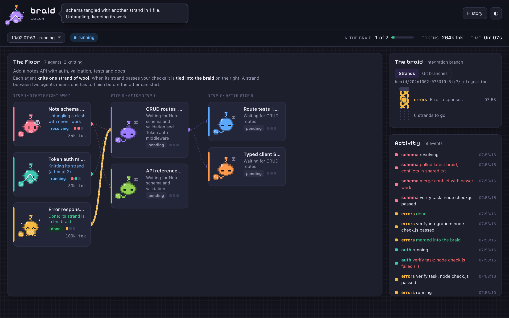
</p>

<p align="center"><sub>The dashboard in the middle of a run. One strand is already tied into the integration branch; others are being knitted, checked, or untangled after a merge conflict. This is <code>braid demo</code>: scripted agents, nothing is spent.</sub></p>

Contents: [How it works](#how-it-works) · [Install](#install) · [Use](#use) · [Desktop app](#desktop-app-macos-and-windows) · [Watch it live](#watch-it-live) · [Plan format](#plan-format) · [Stopping and limits](#stopping-and-limits) · [Open a pull request](#open-a-pull-request) · [Clean up](#clean-up) · [Sandbox](#sandbox) · [Where things live](#where-things-live) · [Environment](#environment) · [Develop](#develop) · [Verified where](#verified-where)

## How it works

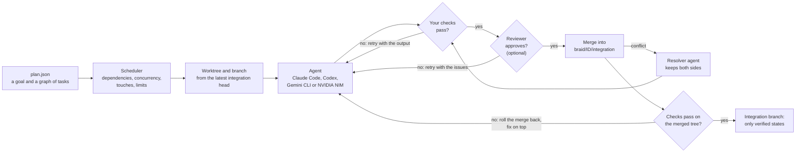

Tasks run in parallel up to `concurrency`, each in its own worktree, and a task starts only when everything it depends on has
been merged. Merges happen one at a time. Your branches and your working tree are never written to: you review
`braid/<runId>/integration` and merge it yourself, or open a pull request for it with `braid pr`.

## Install

```bash
npm install
npm run build
npm link   # puts `braid` on PATH
```

You need Node 22 or later, git, and at least one agent: a signed-in CLI (`claude`, `codex` or `gemini`) or an NVIDIA API key for the `nim` agent.
Run `braid doctor` to see what is missing and how to install it.

### Windows

**The app (recommended):** download `Braid_<version>_x64-setup.exe` from the [releases](https://github.com/gauransh18/braid/releases)
and run it. It installs for your user (no administrator needed) and works like the Mac app: a small launcher (open a
repository, recent repositories, a demo), a dashboard window per repository, a notification-area icon, and Settings for
agents, models and API keys (keys are kept in Windows Credential Manager). It needs [git for Windows](https://git-scm.com/download/win)
and at least one agent (Claude Code, Codex or Gemini CLI) or an NVIDIA API key. It is not code-signed yet, so SmartScreen may
say "Windows protected your PC": choose **More info**, then **Run anyway**. It needs the Microsoft WebView2 runtime, which Windows 11 has
and the installer fetches on Windows 10.

**The command line:** `braid-windows-x64.exe` is a command-line program: double-clicking it only explains that. Open PowerShell
or Windows Terminal in your project folder and run it there, for example `.\braid-windows-x64.exe doctor`; rename it to
`braid.exe` and put it on your PATH to run it as plain `braid`. It runs on CPUs without AVX2, and on Windows on ARM through
emulation. Every release is tested on real Windows machines (x64 and ARM) before it is published: the program end to end, and
the app by installing it and launching it.

Agent CLIs installed with npm are `.cmd` files on Windows, and braid runs those through `cmd.exe`. cmd.exe cannot be given an
argument that holds a quote, a percent sign or a line break safely, so braid refuses such an argument instead of mangling it,
and sends free text (a prompt, a pull request body) on standard input. The same goes for `BRAID_GH_BIN` when it names a `.cmd`
or `.bat` file. Some newer work was never run on Windows: see [Verified where](#verified-where).

### Single-file executable

No Node needed. `npm run build:binary` compiles braid, dashboard included, into one file with
[Bun](https://bun.sh): `dist/bin/braid-<platform>` (about 58 MB on macOS arm64). Add `-- --all` to also build macOS x64,
Windows x64 and Linux x64 (Bun downloads each runtime). Pushing a `v*` tag builds all of them on GitHub and attaches
them to a release, with a `SHA256SUMS` file (`.github/workflows/release.yml`). git and the agent CLIs stay separate installs.

## Use

```bash
# 1. Draft a plan from a goal (read-only agent), then edit it
braid plan "add rate limiting to the API" --verify "npm test" --out plans/rate-limit.json

# 2. Run it
braid run plans/rate-limit.json

# 3. Inspect and merge
braid status
git log --oneline main..braid/<runId>/integration
git merge braid/<runId>/integration

# 4. Or open a pull request for it (needs gh), and later clear away what runs leave behind
braid pr
braid clean --dry-run
```

`braid --help` lists every command and flag. `braid run` and `braid resume` take `--concurrency N`, `--replan N`,
`--task-budget-tokens N`, `--budget-tokens N`, `--timeout MIN`, `--sandbox IMAGE`, `--keep-worktrees` (keep the worktrees of
tasks that succeeded) and `--watch`. The first six override the plan field of the same meaning for that run (see
[Plan format](#plan-format)).

| Command | What it does |
| --- | --- |
| `braid plan "<goal>"` | Draft a plan from a goal with a read-only agent; edit it before running |
| `braid run <plan.json>` | Run a plan |
| `braid resume [runId]` | Continue an interrupted or failed run |
| `braid status [runId]`, `braid runs` | Show one run, or list all runs |
| `braid watch [--control]`, `braid demo` | The dashboard for this repo's runs, with or without buttons to start, stop and resume; a scripted demo run |
| `braid pr [runId]` | Push a run's integration branch and open a pull request ([details](#open-a-pull-request)) |
| `braid clean` | Remove the worktrees and branches that finished runs leave ([details](#clean-up)) |
| `braid doctor` | Check that git and an agent CLI are installed |
| `braid models <provider>`, `braid test-provider <provider>` | List a provider's models; check its key, reachability and model |

`braid run` prints each step as it happens. This is an excerpt of a real run (`braid demo`, with scripted agents): three tasks start at
once, one fails its check and is retried, one merges, one hits a merge conflict that a resolver agent untangles without redoing the
task, and a reviewer sends one task back before approving it.

```text
07:51:56 run started on main; integration branch braid/20261002-075156-dw7w/integration
07:51:56 [errors] running
07:51:56 [auth] running
07:51:56 [schema] running
07:52:02 [auth] verify (task) `node check.js` -> fail (1)
07:52:02 [auth] running
07:52:03 [schema] verify (task) `node check.js` -> pass
07:52:03 [schema] merge -> ok
07:52:03 [schema] verify (integration) `node check.js` -> pass
07:52:03 [schema] done
07:52:03 [errors] merge -> conflict
07:52:03 [errors] pulled latest integration: conflicts in shared.txt
07:52:03 [errors] resolving
07:52:07 [errors] conflicts resolved
  ...
07:52:18 [routes] review -> changes requested: DELETE /notes/:id does not check the note owner; PATCH accepts unknown fields
07:52:18 [routes] running
07:52:30 [routes] review -> approved
07:52:30 [routes] merge -> ok
07:52:30 [routes] verify (integration) `node check.js` -> pass
  ...
07:52:37 run done; 948k tok
```

Press Ctrl-C to stop the agents. Work already merged stays on the integration branch.

To continue an interrupted or failed run, keep the merged work and retry the rest:

```bash
braid resume [runId]   # defaults to the newest unfinished run
```

## Desktop app (macOS and Windows)

`npm run build:desktop` builds the app with [Tauri](https://tauri.app): `Braid.app` and a `.dmg` (about 30 MB) on a Mac, an installer (`Braid_<version>_x64-setup.exe`) on Windows. Everything below applies to both unless it says otherwise. Needs Rust, Bun and the Tauri CLI (`cargo install tauri-cli --version "^2" --locked`). Output is in `desktop/src-tauri/target/release/bundle/`. The macOS app is signed ad hoc, not with an Apple Developer ID, and not notarized, so macOS refuses to open a downloaded copy at first (on Apple silicon the first message can read "damaged"). Allow it under **System Settings > Privacy & Security > Open Anyway**, or run `xattr -cr /Applications/Braid.app` once. Building it yourself (`npm run build:desktop`) signs the whole bundle ad hoc, with the hardened runtime off because the bundled `braid` is a Bun executable that needs to compile code at run time, and a copy that was never downloaded opens without any of this.

<p align="center">
  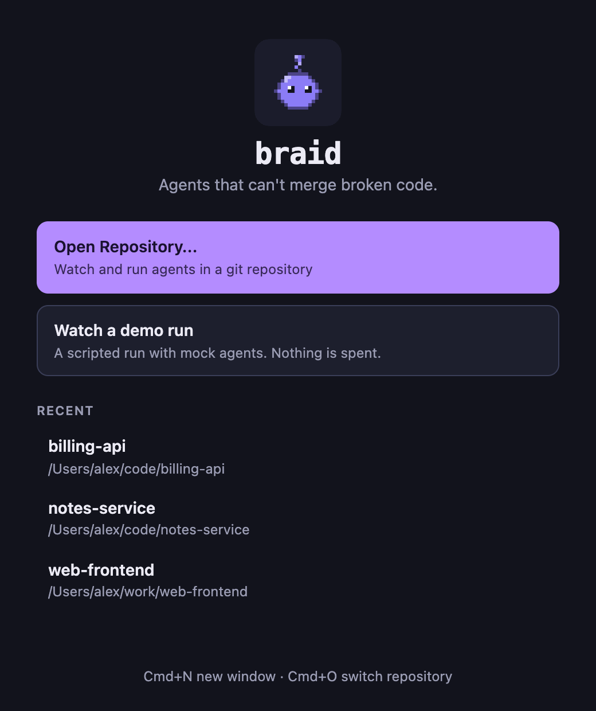
  &nbsp;&nbsp;
  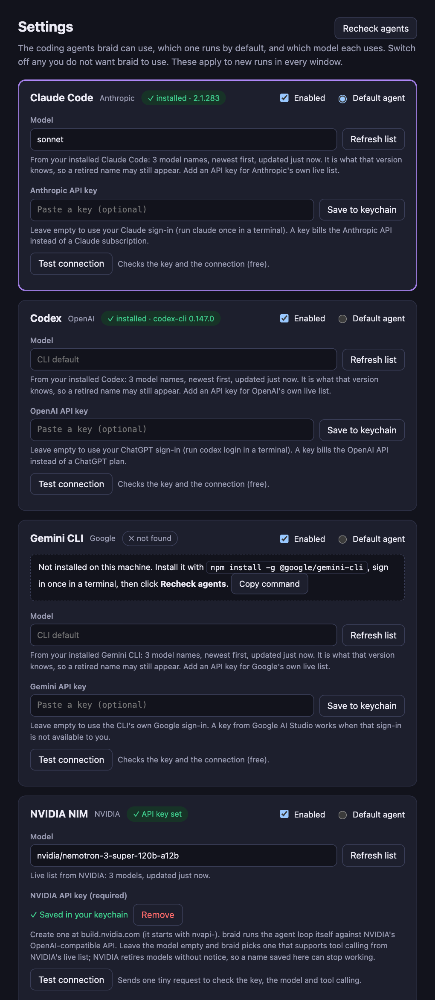
</p>

<p align="center"><sub>The launcher and Settings windows. The repositories and the agents they list are sample data.</sub></p>

- **Launcher.** The app opens a small launcher window, not an empty dashboard: **Open Repository...**, **Watch a demo run** (mock agents, nothing spent) and a list of recent repositories. Picking one opens a dashboard window for it, with the single-file braid executable running in the background as that repository's server.
- **Several repositories.** **File > Open Repository...** (Cmd+O) switches the current window to another repository, and **File > New Window** (Cmd+N) brings up the launcher again so you can watch several repositories at once, each with its own window and server. Both are also in the Dock icon's right-click menu and the menu-bar icon's menu. `Braid --repo PATH --repo PATH2` skips the launcher and opens one window per repository.
- **Starting runs.** From the window (**New run**), or with `braid run`: the window shows them live.
- **Settings** (**Braid > Settings...**, Cmd+,; on Windows: File > Settings) manages the agents:
  - Which of Claude Code, Codex and Gemini CLI are installed (with install commands for the ones that are not), plus **NVIDIA NIM**, a hosted API: add an `nvapi-` key and pick a model, and braid runs the agent loop itself.
  - Which agent is the default and which model each uses. Type any name, or pick from a current list, which Braid refreshes every time it starts and on **Refresh list**: the provider's own live list when you saved a key, otherwise the model names read from the installed Claude Code, Codex or Gemini CLI itself (they follow the CLI when you update it). The Claude aliases `opus`, `sonnet` and `haiku` always mean the newest.
  - Optional provider API keys. Keys go in the macOS Keychain (Windows Credential Manager on Windows), never in a file, and the window can only show that one is set. They are passed to agents only through the environment of the running server. Leave a key empty to use the CLI's own sign-in.
  - An **Enabled** switch per agent: a switched-off agent is never used as the default, and a plan that asks for it is refused with a clear message.
  - A **Test connection** button per provider (key, reachability, the chosen model and, for NIM, tool calling). Changes apply to new runs in every window at once.
- **Closing and quitting.** Closing a window stops its server, and the last window hides to the menu bar, whose icon shows how many runs are active (**Quit Braid** really quits). The app does not kill a server that is running something: it writes `quit` to the server's standard input, which the server treats like a first Ctrl-C (agents stopped, merged work kept, the run saved so **Resume** works), and it kills the server only if it is still there 20 seconds later. A server whose input closes (the app was killed or crashed) stops the same way. Closing a window does this in the background; **Quit Braid** waits for every server, so it can take a few seconds to exit while a run winds down (agents usually stop at once; a command that ignores SIGTERM takes about 5 seconds). The demo server, and a server that never came up, are killed at once.
- **Notifications.** macOS notifications announce a finished, failed or stopped run and each task that fails, but only while no window is focused (the first launch asks for notification permission).

## Watch it live

```bash
braid run plans/rate-limit.json --watch   # run + dashboard
braid watch                               # dashboard for this repo's runs (any terminal)
braid demo                                # scripted mock run, no agents
```

The dashboard opens at `http://127.0.0.1:4777`. It only listens on this machine and is read-only by default.

`braid watch --control` (and the desktop app) turns an empty repository into a guided start: describe a goal, and braid
drafts a plan you can review and edit (tasks, dependencies, the command every task must pass, pre-filled from your
`package.json`, `Cargo.toml`, `go.mod` or pytest config), and start it. It also shows which agents are available as clickable chips: click one to switch that agent off or on (saved in Settings, and applied in every open window). Later runs use the **New run** button (same steps), plus **Stop** and **Resume**. You can also load a saved plan
from `plans/`. One run is active at a time. These endpoints can
start agents, so they need a per-session token (from `BRAID_CONTROL_TOKEN`, or generated and printed as `#token=...`
after the URL; it never travels in argv or the request URL), and they refuse requests from other origins. A run started
this way lives in the `braid watch` process: stopping that process with Ctrl-C stops the run and saves it, so `braid resume`
can continue it. Closing or reloading the page while a plan is being drafted stops the planner agent (there is no cancel
button yet). Reading runs and transcripts does not need the token.

<p align="center">
  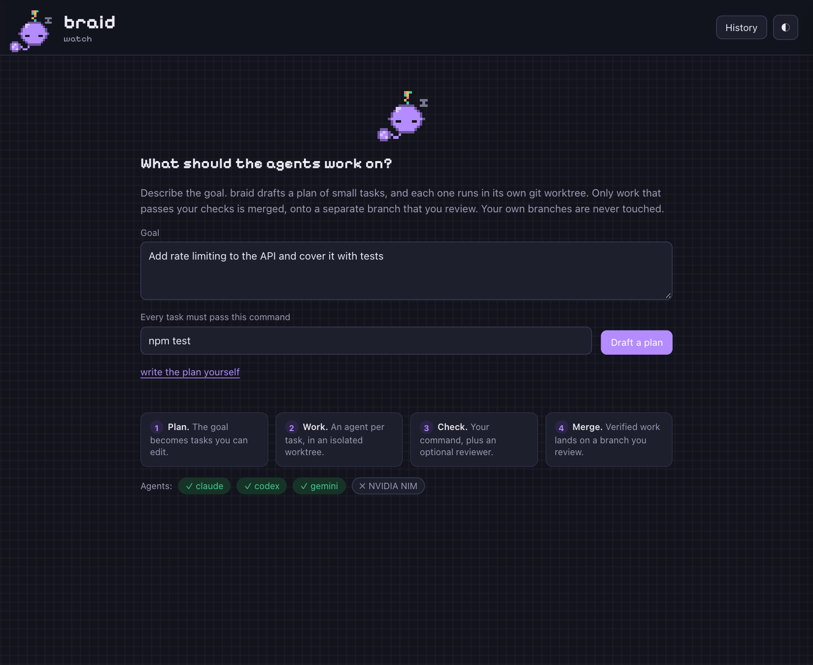
</p>

The dashboard shows:

- **The floor:** each agent is a pixel blob that **knits a strand of wool** in its task's colour, and its mood shows what it is doing: a ball of wool waiting beside it, needles clicking over a growing swatch while it works, a magnifier while its stitches are checked (your tests), glasses while a reviewer looks, jumping while it ties the strand into the braid, a fringed swatch when done, tangled wool when failed, wrapped in its own wool when blocked. Under each name a plain sentence says what it is doing or what it is waiting for (including "Waiting for X: it changes the same files" when `touches` holds a task back), columns are numbered steps, and dependencies are strands of wool that thin out until the first agent finishes, turn solid when it has, and twist through while the next agent works.
- **The braid:** the integration branch drawn as a rope that gains a strand in the task's color on every verified merge.
- **Usage:** token counts (fresh, cached, output) per task and per run. braid shows no dollar amounts.
- **Activity:** every harness event (verify results, review verdicts, conflicts, rollbacks).
- **Git branches:** a switch beside the braid. For each task branch: its commits, a diffstat, and whether it is already in the integration branch. Read-only.
- **History:** the whole repo's commit graph across every local branch, remote-tracking branch and tag. **Fetch from GitHub** needs `--control` (or the app) and runs `git fetch --all`, which adds objects and moves remote-tracking branches such as `origin/main`. It never touches a local branch or your working tree, and prunes nothing.
- **Inspector:** click a desk to see the task prompt, its checks and the live agent transcript for each attempt.
- **Knot:** the mascot, which narrates what the run is doing.

<p align="center">
  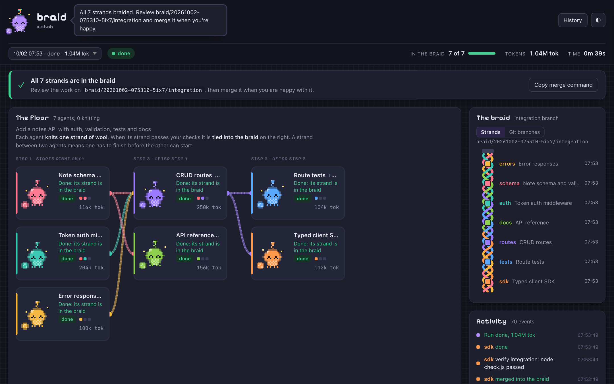
</p>

<p align="center"><sub>A finished run: all seven strands are in the braid, and the banner gives the branch to review and a button that copies the merge command.</sub></p>

<p align="center">
  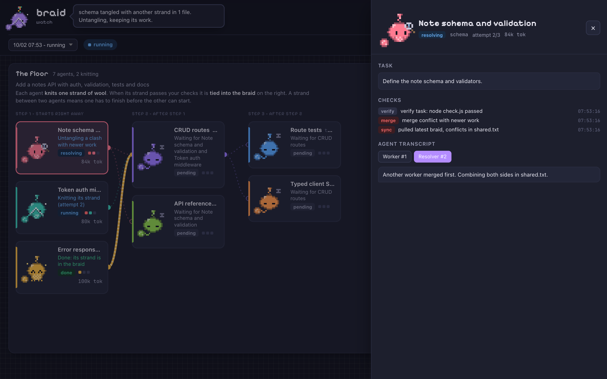
</p>

<p align="center"><sub>The inspector: click a desk to read the task, the checks and merge steps it has been through, and the agent's transcript for each attempt (here, an agent untangling a merge conflict).</sub></p>

<p align="center">
  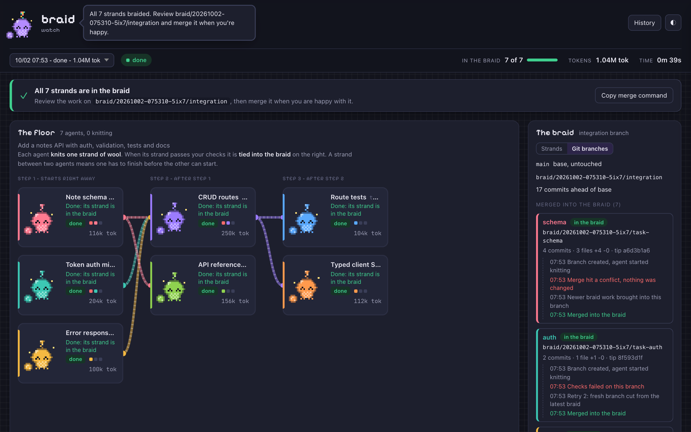
  &nbsp;
  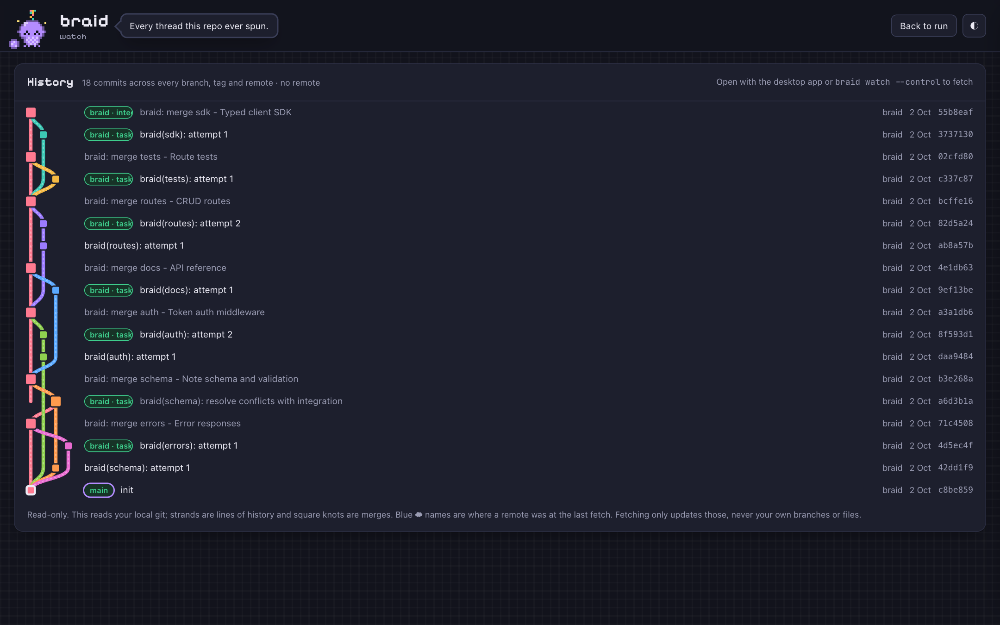
</p>

<p align="center"><sub>The Git branches view (left) and the History view (right).</sub></p>

## Plan format

See [examples/plan.json](examples/plan.json). The fields are:

| Field | Level | Meaning |
| --- | --- | --- |
| `goal` | plan | Shared context given to every agent |
| `base` | plan | Branch to start from (default: current) |
| `concurrency` | plan | Maximum tasks running at once (default 3) |
| `budgetUsd` | plan | Optional, advanced: stop scheduling once this much has been spent. Nothing in the app or CLI asks for it or shows cost |
| `taskBudgetTokens` | plan | What one task may use, in fresh input and output tokens summed over all its agent calls (cached input is not counted), before it fails. Default 3 million; `0` means no limit. A task that was resumed counts from the tokens it already held, so it gets a fresh allowance. Also `--task-budget-tokens N` |
| `budgetTokens` | plan | An explicit cap for the whole run: stop starting tasks once the run has used this many fresh input and output tokens. No default, so a plan that does not set it has no run-wide cap. Counts from each `braid run` or `braid resume`. `0` (or `--budget-tokens 0`) removes only this run-wide cap, never the per-task allowance above. Also `--budget-tokens N` |
| `budgetTokens` | task | The token allowance of this one task, instead of `taskBudgetTokens`. `0` means no limit for this task |
| `timeoutMin` | both | Minutes one agent call may run before it is stopped and the attempt retried. Default 30; `0` means no limit. Also `--timeout MIN` |
| `maxReplans` | plan | Times the planner may split or rewrite a task that failed for good (default 0, off) |
| `sandbox` | plan | Run setup, verify and optionally the agent in a Docker/Podman container. See [Sandbox](#sandbox) |
| `setup` | plan | Commands run in each fresh worktree, e.g. `npm ci` |
| `driver`, `model` | both | `claude` (default), `codex`, `gemini`, `nim` (NVIDIA NIM, needs `NVIDIA_API_KEY`), `mock` |
| `verify` | both | Commands that must exit 0 |
| `verifyMerge` | both | Commands for the check on the combined tree after a merge (they run in the integration worktree). Default: the plan's `verifyMerge`, then the task's own `verify`. Lets a task run the full suite on its own and a quick smoke test on the merge; `[]` skips the check after the merge |
| `review` | both | Run a read-only reviewer on the diff |
| `reviewer` | both | Which agent reviews: `{"driver": "codex", "model": "..."}`. A field set on the task wins over the plan's. What is left out falls back to the task's own agent and model, and a model only carries over to the agent it was meant for. Only used when `review` is on |
| `touches` | task | Paths or globs the task expects to change, such as `["src/auth/**", "package.json"]`. Two tasks whose `touches` could match the same path never run at the same time: the second waits, and the dashboard says so. A task with no `touches` is never held back and never holds another back. See below |
| `maxAttempts` | both | Tries, including retries with feedback (default 2) |
| `allowedTools` | both | Agent tool allowlist (default: no Bash) |
| `maxTurns` | both | Agent turn cap |
| `id`, `title`, `prompt`, `deps` | task | The task itself |

Values set on a task override the plan-level values. `taskBudgetTokens` is the plan's default for the task-level `budgetTokens`.

**`touches`.** Patterns are relative to the repository, with `*`, `**`, `?`, `[...]` and `{a,b}`; case is ignored. braid errs toward
"overlap": a false match only makes two tasks take turns, while a miss costs a merge conflict. A trailing slash, or a last name with
no wildcard and no dot (other than a leading one, as in `src` or `.github`), also covers everything under it. A directory whose name
has a dot inside (`vendor/github.com`) is read as a file, so write it as `vendor/github.com/` or `vendor/github.com/**`. A bracket
name such as `app/[id]` or `[...slug]` is read as a directory. A task is only held back by tasks that are running, so tasks that all
overlap run one at a time and cannot wait for each other forever.

**Reviewer.** A reviewer that fails without giving a verdict (a model it does not have, no login) fails the task and names the
reviewer, instead of sending the worker back to redo verified work. A reviewer whose program is not installed stops new tasks that
need it for the rest of the run, the way an agent out of credit does; `braid resume` carries on once it is fixed.

## Stopping and limits

- **Stop.** Ctrl-C, or **Stop** in the dashboard, stops the agents and any setup or verify command that is running, together with what they started. Agents are asked to stop the way a terminal would (SIGINT), so Claude Code and Codex clean up their own tool commands, then terminated, then killed after five seconds; what an agent left behind in a session of its own is found and killed too. Merged work stays; `braid resume` continues. A second Ctrl-C, a short while after the first, quits at once. Closing the terminal stops the run too. If a run's process is gone (force-quit, crash), the dashboard shows it as stopped, with Resume.
  - **Git hooks.** Stop also ends git while it sits in a hook, when it is making a commit or a merge or adding a task's worktree (a pre-commit hook that runs your whole test suite, say). The hook is killed and the worktree stays usable: a merge left half done is aborted, and a lock file the killed git left behind is removed when no git process is using that worktree. A task stopped there ends as skipped, and `braid resume` carries on. A resume also removes lock files that a git killed outright (a second Ctrl-C, a crash) left on the run's own branches.
  - **Not covered.** Creating the run's own integration worktree (at the start of a run and of a resume) cannot be interrupted: a Stop there is honoured as soon as git returns, and the run ends as aborted with a branch to resume. Git hooks have no time limit of their own either; `timeoutMin` covers agent calls only.
- **Stuck commands.** A setup or verify command that runs longer than 10 minutes is killed with its children and reported as timed out. A command that was stopped never counts as passed, whatever exit code it ended with.
- **Containers.** A sandbox container is removed by name when braid stops normally, on Ctrl-C, SIGTERM or when the terminal closes. If braid itself is killed with SIGKILL or crashes, it cannot do that, so every container braid starts is labelled `braid=1`, `braid.pid=<pid>` and `braid.host=<host name>` (add the PID namespace on Linux). The next run that uses a sandbox removes labelled containers whose braid process is gone, once the container runtime answers, and says so: a `sandbox_sweep` event in the run log and a line in the terminal. `docker ps -a --filter label=braid` shows them. Only containers from the same host and PID namespace are judged: several machines can share one container daemon (a remote `DOCKER_HOST`, Docker Desktop with WSL), and there a pid from elsewhere means nothing. A container from another host, or one with no host label, is left alone, and so is one whose pid is alive, even if that pid has since been reused. A host that was renamed makes its older leftovers look foreign, and they are left alone too. Containers started by versions before the labels have none and are never swept: remove those by hand (`docker ps -a`, then `docker rm -f NAME`). `braid clean` does not touch containers.
- **Provider trouble is not the task's fault.** When an agent call fails because of a rate limit, an overloaded API or a dropped connection, braid waits (20, 40, 80, then 160 seconds) and tries the call again without using up one of the task's attempts or telling the agent its work was rejected. Only what the provider or the CLI itself reported is judged, never the agent's own words. If it keeps failing, the task fails as `agent unavailable`; if a limit is reached, or that agent runs out of usage, while braid waits to retry, it fails with that reason instead. If the account is out of usage or credit, no new task for that agent starts (tasks on other agents carry on) and `braid resume` carries on once it is back.
- **Safety limits.** Every run has them even if the plan sets none: an agent call is stopped after 30 minutes (`timeoutMin`), and each task may use 3 million fresh input and output tokens (`taskBudgetTokens`, or `budgetTokens` on the task). They stop a runaway, not a big task; raise them or set them to 0 in the plan (or with `--timeout` and `--task-budget-tokens`).
  - **Per task.** The allowance counts what all of the task's agent calls used: worker, conflict resolver, reviewer and replanner. Cached input is not counted. It is checked at the start of each attempt, after setup, before a replan and between the retries of a call, so one call can still go past it. A task that reaches it fails with `token budget exhausted for this task`. The other tasks keep running, and the tasks that depend on it are blocked. A task that was resumed counts from the tokens it already held, so it gets a fresh allowance. A task over its allowance is not handed to the replanner (that call would be charged to the same task); the replacement tasks of a replan inherit the failed task's `budgetTokens` and get an allowance of their own.
  - **Whole run.** `budgetTokens` in the plan (or `--budget-tokens N`) is a separate, optional cap on the run. It has no default. When it is set, the run starts no new task or attempt once it has used that many tokens since this `braid run` or `braid resume`; a call that is already running finishes. `budgetTokens: 0` removes only this cap, not the per-task allowance. A run with many tasks can use more than 3 million tokens in all.
  - **Caveats.** A call that is killed counts only the tokens known for it. Claude Code and Codex stream their figures, so most of what it used is seen. Gemini reports only at the end: for a Gemini call that is stopped, or that ends without a successful result, braid estimates the tokens from what streamed (about 4 characters per token; reasoning tokens and the CLI's own prompt never stream, so the real figure is higher). A Gemini call that succeeds but reports no usage counts 0, on purpose, so that the canary can see the CLI changed. NIM and other OpenAI-compatible endpoints that report no cached tokens: only the part of the conversation that is new since the previous turn counts as fresh input, and the rest as cached. That is an approximation.
- **No terminal.** Setup, verify and agents run without a controlling terminal, so a prompt for a git password, an ssh passphrase, `sudo` or a gpg passphrase fails instead of asking. Use a credential helper or a key. When a failing setup or verify command printed such a failure, the report (on the dashboard, and in the agent's next prompt) ends with a line starting `Hint: braid runs this command without a terminal` that says what to do.

### What a stopped run looks like

When a run stops short, the dashboard says why and what to do next. These are real runs, written by the orchestrator with a scripted agent.

<p align="center">
  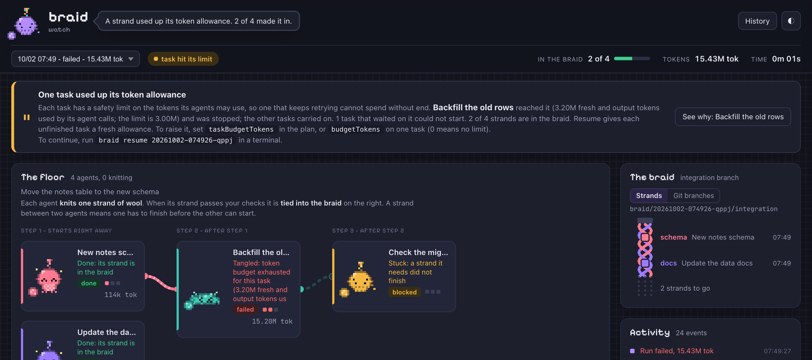
</p>

<p align="center">
  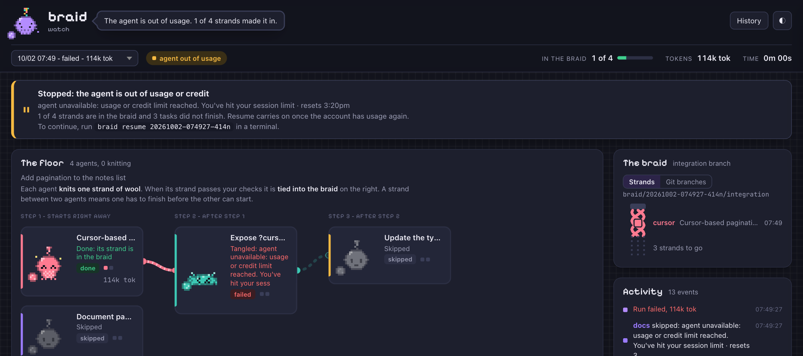
</p>

<p align="center">
  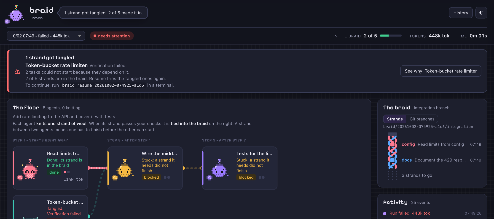
</p>

## Open a pull request

```bash
braid pr [runId] [--base BRANCH] [--draft] [--remote origin] [--dry-run] [--allow-partial]
```

This pushes a run's integration branch and opens a pull request for it with the [GitHub CLI](https://cli.github.com). It takes
the newest run that has an integration branch, or the one you name. A run that is still going is refused. A run that did not finish
is refused too, because its branch holds only the tasks that merged; `--allow-partial` opens the pull request anyway.

- **What it pushes.** Only `braid/<runId>/integration`, never the base branch, and never with force: if the remote already has a
  different branch of that name, the push fails and braid says to look at it first. `--remote` picks the remote (default `origin`),
  `--base` the branch the pull request is against (default: the branch the run started from), `--draft` opens it as a draft.
- **What it says.** The title is the first line of the plan's goal. The body is built from the run's `state.json` and `plan.json`: the
  goal, a table of the tasks with status, attempts and tokens, the verify commands, and which tasks merged. It is cut at about 30,000
  characters.
- **gh.** It needs `gh` installed and signed in; `BRAID_GH_BIN` names another program, which is mostly for tests. Without gh, braid
  pushes nothing: it prints the title, the body and a `git push` line (for a GitHub remote also a compare link you can open in the
  browser) and exits with 1. `--dry-run` prints the same and changes nothing. If the push worked and gh failed, run `braid pr`
  again once that is sorted out; the push is then a no-op.
- **No terminal.** git and gh run without one, so a prompt for a password fails instead of hanging. Use a credential helper or a key.
- **Several remotes.** `--remote` only chooses where the branch is pushed. `gh` decides which repository the pull request goes to
  (`gh repo set-default`), and that can be a different one. The push also follows your git config, so `push.followTags` would push
  annotated tags along with the branch.

## Clean up

```bash
braid clean [--older 7d|12h] [--dry-run] [--integration [--force]] [--runs]
```

Runs keep the worktrees of failed tasks for inspection, and every task leaves a branch. `braid clean` removes what finished runs
left behind. By default that is only the kept task worktrees (`.braid/worktrees/<runId>`) and the `braid/<runId>/task-*` branches of
runs that are over: done, failed, aborted, or marked running by a process that is gone. It never touches a run whose process is
alive, a run whose `state.json` cannot be read (a run that is just starting looks the same), integration branches, run folders or
your own branches, unless you ask. A run marked running by a process on another host or in a container counts as alive, since its
pid cannot be looked up here.

- `--older 7d` or `12h`: only runs that ended at least that long ago (counted from the end of the run; for one that crashed, from its
  last save).
- `--dry-run`: lists what would go and changes nothing. It is a prediction: it knows about a branch checked out in your own
  worktree, but not about every other refusal from git or a locked file (on Windows), which only show up on a real run.
- `--integration`: also deletes integration branches that another branch of yours already holds (a local or remote-tracking branch
  that is not under `braid/`, such as `origin/main`). Remote-tracking branches are only as current as your last fetch, and a squash or
  rebase merge does not count as merged, so such a branch is kept. The branch of a run that is not `done` is kept too, since you can
  resume the run from it, unless you add `--runs` (the run goes as well) or `--force`.
- `--integration --force`: also deletes integration branches that are not merged anywhere else, and prints each with its old sha so
  you can bring it back.
- `--runs`: also deletes the run folders under `.braid/runs`. A folder stays while any branch of its run was kept or could not be
  deleted, because `braid pr`, `braid resume` and the next `braid clean` find the run through it.

Know before you run it: a failed task's unmerged commits are deleted with its branch (the output says how many were not in the
integration branch), and uncommitted files in its kept worktree are lost without a warning. A branch that is checked out in one
of your own worktrees is kept. A branch that cannot be deleted (a stale lock, no permission) is reported as FAILED, and braid
exits with 1. A symlink under `.braid/worktrees/<runId>` is unlinked and what it points at is left alone. Worktrees whose run
folder is gone are removed as leftovers. A run's own `integrationBranch` in `state.json` must be `braid/<runId>/integration`, or
it is left alone.

## Sandbox

A worktree is not a sandbox: verify and setup commands run on your machine, and an agent that is allowed
`Bash` can reach anything you can. Add a `sandbox` to the plan to run them in a container instead
(needs Docker or Podman running):

```json
"sandbox": { "image": "node:22", "agent": true, "env": ["CLAUDE_CODE_OAUTH_TOKEN"], "memory": "4g" }
```

- **Setup and verify** run in a throwaway container. Only that task's worktree is mounted, at `/work`. All capabilities are dropped and it runs as you. Verify has no network unless `"network": true`; setup keeps it so `npm ci` works.
- **`agent: true`** runs the agent CLI in the container too, so allowing `Bash(...)` is safe: it cannot see your other branches, your `.git` or your home directory. The image must contain the CLI, see [examples/sandbox](examples/sandbox). `env` lists variable names to pass in; braid never reads their values.
- `braid run plan.json --sandbox node:22` sets just the image. Set `BRAID_CONTAINER_RUNTIME` to pick `podman` or another binary.
- Inside the container the worktree's `.git` is not available, so commands that call git will fail.
- Containers are labelled, and the next sandboxed run removes the ones a killed braid left behind: see [Stopping and limits](#stopping-and-limits).

## Where things live

`.braid/runs/<runId>/` holds the plan, state, event log and every agent transcript.
Worktrees live under `.braid/worktrees/`, and the worktrees of failed tasks are kept for inspection. Nothing deletes them for
you: [`braid clean`](#clean-up) does.

## Environment

| Variable | Meaning |
| --- | --- |
| `BRAID_CLAUDE_BIN`, `BRAID_CODEX_BIN`, `BRAID_GEMINI_BIN`, `BRAID_GH_BIN` | The program to run for that agent CLI, or for `gh` in `braid pr`, instead of finding it on `PATH`. Mostly for tests and odd installs |
| `BRAID_CONTAINER_RUNTIME` | The container runtime for a sandbox (`podman`, or another binary). Default: `docker`, then `podman` |
| `BRAID_CONTROL_TOKEN` | The token for `braid watch --control`. Without it one is generated and printed after the URL |
| `BRAID_EXIT_ON_STDIN_CLOSE` | With `1`, `braid watch` stops like a first Ctrl-C when the line `quit` arrives on its standard input, or when that input closes. The desktop app sets it. Standard input is not read otherwise. A launcher that sets it must keep the input open: with it closed, or `/dev/null`, `watch` starts to stop at once |
| `BRAID_PRICES` | A JSON file of model prices, see [docs/DESIGN.md](docs/DESIGN.md) |
| `BRAID_SETTINGS_FILE` | The file the dashboard's agent switches save to. The desktop app sets it to the file Settings uses |
| `NVIDIA_API_KEY`, `BRAID_NIM_BASE_URL` | The key for the `nim` agent, and a different OpenAI-compatible endpoint for it |
| `BRAID_ANTHROPIC_BASE_URL`, `BRAID_OPENAI_BASE_URL`, `BRAID_GEMINI_BASE_URL` | A different endpoint for the live model lists (`braid models`, Settings). Mostly for tests |

Design and roadmap: [docs/DESIGN.md](docs/DESIGN.md).

## Develop

```bash
npm test   # builds, then runs unit and end-to-end scheduler tests with a mock driver
cargo test --manifest-path desktop/src-tauri/Cargo.toml   # the desktop app's Rust tests
node scripts/canary.mjs --fake   # the canary against stand-in agents, no network
```

- **Screenshots.** The images in `docs/images/` come from `node scripts/screenshots.mjs` (`npm run screenshots`), which needs Google Chrome (or `BRAID_CHROME`) and a built braid. The dashboard shots are of a real `braid demo` run and of real runs that the orchestrator wrote with a scripted agent; the desktop launcher and Settings are the app's own pages with sample data standing in for the Tauri commands. `--only name,name` redoes some of them.
- **Editor.** `.editorconfig` sets 2 spaces, LF and a final newline (4 spaces for Rust and Python).
- **CI** (`.github/workflows/ci.yml`) runs `npm test`, the binary build and `scripts/smoke.mjs` on Linux, Windows and macOS on every push, and the desktop app's Rust tests on macOS (job `desktop-rust`; Windows runs them in `desktop-windows.yml`, after the app is built). The macOS Rust job runs on every push and pull request, because one job in a workflow cannot have its own path filter; `rust-cache` keeps it cheap. `tauri-build` needs the sidecar file `desktop/src-tauri/binaries/braid-<rust host triple>` to exist, even as an empty file, so create one before running `cargo test` yourself.
- **The dashboard script** (`ui/index.html`) is checked by `test/ui.test.ts`: every inline script is syntax-checked, and its functions run against run states that the real orchestrator wrote. The page matches the orchestrator's wording for the token limits and for an agent out of usage (`token budget exhausted`, `agent unavailable: usage or credit limit reached`), so changing that text in `src/orchestrator.ts` or `src/failures.ts` fails a test until the page is changed with it.
- **The canary** (`.github/workflows/canary.yml`) runs weekly, and by hand (Actions, canary, Run workflow, optionally with a list of agents), against the real agents. Agent CLIs change what they print without notice, and the unit tests only know the shapes captured once. It runs a two-task plan through the built braid for each agent, and fails when the run, the merge, the files, or the token count and final summary braid reads are not what they should be. It needs the repository secrets `ANTHROPIC_API_KEY`, `OPENAI_API_KEY`, `GEMINI_API_KEY` and `NVIDIA_API_KEY`, skips an agent whose secret is missing, and fails when none could run or when an agent that was named in `drivers` could not (`--strict`). Optional repository variables `CANARY_MODEL_CLAUDE`, `CANARY_MODEL_CODEX`, `CANARY_MODEL_GEMINI` and `CANARY_MODEL_NIM` pick cheaper models. It costs a few cents per agent. Locally, `node scripts/canary.mjs` runs every agent that is installed and signed in, and `--fake` runs it against stand-in agents with no network.

### Verified where

Most of this was developed and run on macOS. On commit `3ab4825`, the CI workflows passed on all three systems:

- **Linux and macOS.** All 399 tests pass, and `scripts/smoke.mjs` passes against the compiled binary. The suite also ran in a Debian container with Node 22.
- **Windows.** 313 tests pass and none fail. About 86 of the 399 do not run there, because they need POSIX shell hooks, signals, `ps`, symlinks, or a script standing in for an agent, `gh` or the container runtime: git stopping in hooks, stale lock files, `braid clean` with a symlink, `braid pr`, the sidecar quit protocol, the command-line signal tests and the canary. The smoke test passes against the compiled `braid-windows-x64.exe`, with a stand-in agent installed as a `claude.cmd` shim the way npm installs one, so a `.cmd` wrapper received arguments with spaces and parentheses intact. The desktop app was built, installed and launched on a real Windows machine, and its Rust tests pass there and on macOS. The tests that ran on Windows include stopping a command, and the child it started, on a timeout, an abort and quitting braid (`taskkill`, since Windows has no process groups).

What has not been seen:

- **Windows.** What the skipped tests cover was not run there: git stopping in hooks and the stale lock files it leaves, `braid clean` and `braid pr`, the command-line signal handling, and the quit protocol over a Windows pipe. The refusal of unsafe arguments for a `.cmd` wrapper (a quote, a percent sign or a line break) is unit-tested with a simulated platform and has not met a real `.cmd` file; the smoke test passes only ordinary arguments. Escalating to SIGKILL and asking an agent to stop with SIGINT are POSIX behaviour and have no Windows counterpart to run. Removing a stale lock file needs a process list, and braid has none on Windows, so a stale `index.lock` is left there for the worktree's removal.
- **Containers.** The sandbox was checked against real Docker for setup and verify. The sweep of stale containers was only checked against a stand-in runtime, and the `docker ps --format` template it uses was only checked to be accepted by a real Docker with nothing to list; it never removed a real container. Podman's support for that template, and running the agent itself in a container, were not checked.
- **The desktop app.** The Rust tests cover the stop logic with stand-ins, and the Node side of the quit protocol is tested against the compiled CLI (`test/containers-sidecar-stdin.test.ts`). CI launched the app on Windows and found its window and background server. Writing `quit` through Tauri's `CommandChild` to the real sidecar, and the app winding a run down on quit, were not seen on any system, and the app was not launched on macOS for this. Quit can take up to 20 seconds when a run does not stop.
- **Real agents.** The canary has never run against real agents, so the first run may fail on authentication or a changed flag instead of finding drift. The Gemini and NIM drivers have not been run against a signed-in install or the real NVIDIA API (see [docs/DESIGN.md](docs/DESIGN.md)).
- **Platform quirks.** The stale lock cleanup reads `ps -axww -o pid=,command=`, which macOS and Linux (procps) have; its tests ran on Ubuntu and macOS in CI. On a minimal `ps` (busybox) braid cannot tell whether git is running and leaves the lock alone.
